# Имитационная модель ДПТ и двухконтурной САУ на STM32

<p>
  
  
  
  
  
</p>

Проект по дисциплине «Встраиваемые вычислительные системы» (ТПУ, осень 2025). На микроконтроллере **STM32F103C8T6** я сделал модель **двигателя постоянного тока (ДПТ)** с силовым преобразователем и **двухконтурной системой управления**: внутри контур тока, снаружи контур скорости.

Настоящего двигателя нет. Двигатель, преобразователь и регуляторы считаются в прерываниях таймеров: модель — 50 000 раз в секунду, регулятор тока — 5000, регулятор скорости — 2500. В модели есть ограничения, как у настоящего привода: напряжение питания 24 В и ток не больше 20 А. Графики смотрю в программе **MCUViewer**, через неё же переключаю режимы прямо во время работы.

<p align="center">
  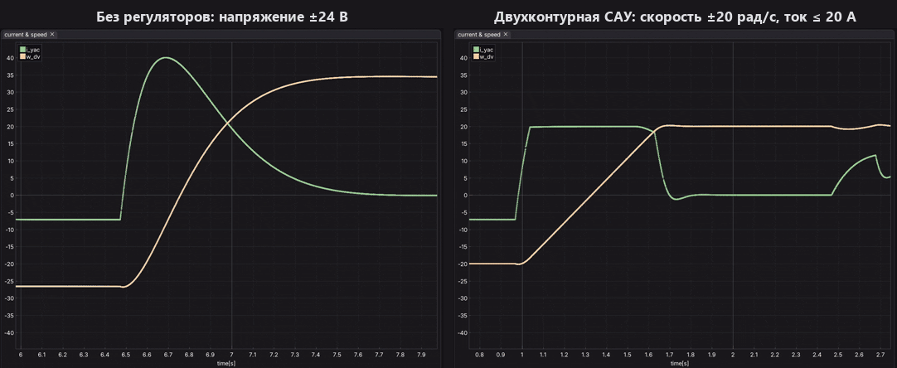
  <br><em>Ток якоря (зелёный) и скорость (оранжевый) в реальном времени: пуск, наброс нагрузки 5 Н·м и реверс. Слева двигатель без регуляторов, справа двухконтурная САУ. Записи синхронизированы, шкалы времени одинаковые</em>
  <br><sub><a href="docs/images/open_vs_control_vertical.gif">Вертикальная версия</a>: графики друг под другом, удобно сравнивать моменты по времени</sub>
</p>

---

## Содержание

- [Имитационная модель ДПТ и двухконтурной САУ на STM32](#имитационная-модель-дпт-и-двухконтурной-сау-на-stm32)
  - [Содержание](#содержание)
  - [Что я сделал](#что-я-сделал)
  - [С чего начинал: ЛБ1 в Simulink](#с-чего-начинал-лб1-в-simulink)
  - [Зачем нужна двухконтурная САУ](#зачем-нужна-двухконтурная-сау)
  - [Как это работает](#как-это-работает)
    - [Структурная схема](#структурная-схема)
    - [1. Модель ДПТ](#1-модель-дпт)
    - [2. Регулятор тока](#2-регулятор-тока)
    - [3. Регулятор скорости и фильтр задания](#3-регулятор-скорости-и-фильтр-задания)
    - [4. Ограничения тока и напряжения](#4-ограничения-тока-и-напряжения)
    - [5. Таймеры и прерывания](#5-таймеры-и-прерывания)
    - [6. Режимы работы](#6-режимы-работы)
    - [7. MCUViewer](#7-mcuviewer)
  - [Как я доводил систему](#как-я-доводил-систему)
    - [Этап 1. Линейная модель, как в лекциях](#этап-1-линейная-модель-как-в-лекциях)
    - [Этап 2. Делаю модель физичной](#этап-2-делаю-модель-физичной)
    - [Грабли](#грабли)
  - [Результаты](#результаты)
  - [Параметры модели](#параметры-модели)
  - [Структура проекта](#структура-проекта)
  - [Сборка и прошивка](#сборка-и-прошивка)
  - [Что можно улучшить](#что-можно-улучшить)
  - [Источники](#источники)

---

## Что я сделал

- Перевёл уравнения ДПТ и преобразователя в разностную форму (метод Эйлера), чтобы их можно было считать на микроконтроллере.
- Написал ПИ-регуляторы тока и скорости. Коэффициенты считаются из параметров двигателя: контур тока настроен на модульный оптимум, контур скорости — на симметричный.
- Нашёл и убрал причины большого перерегулирования по скорости: поменял порядок расчёта регуляторов и добавил фильтр задания. Было 85 %, стало 15 %.
- Добавил ограничения тока (20 А) и напряжения (24 В) с защитой регуляторов от интегрального насыщения. Подобрал настройку контура скорости, при которой система с ограничениями не уходит в автоколебания.
- Разнёс модель, регуляторы и задатчик по трём таймерам. Шаги дискретизации считаются из настроек таймеров, а не вписаны в код числами.
- Сделал три режима работы. Их можно переключать из MCUViewer, а выбранный режим сохраняется после нажатия reset.

## С чего начинал: ЛБ1 в Simulink

Перед этим проектом была лабораторная работа № 1 по этой же дисциплине. В ней я собрал модель ДПТ с независимым возбуждением в Simulink и сделал для неё систему логического управления пуском и остановом через добавочные сопротивления. Двигатель там другой (110 В, 1250 Вт), но уравнения те же. Их я потом перенёс в код микроконтроллера.

<p align="center">
  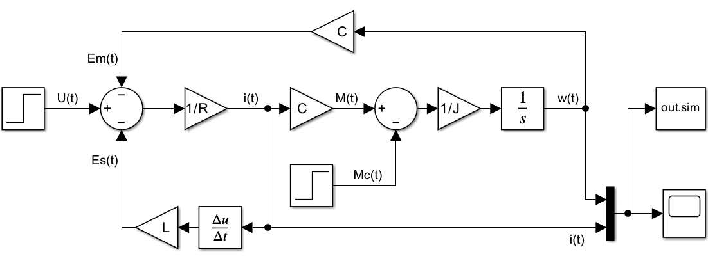
  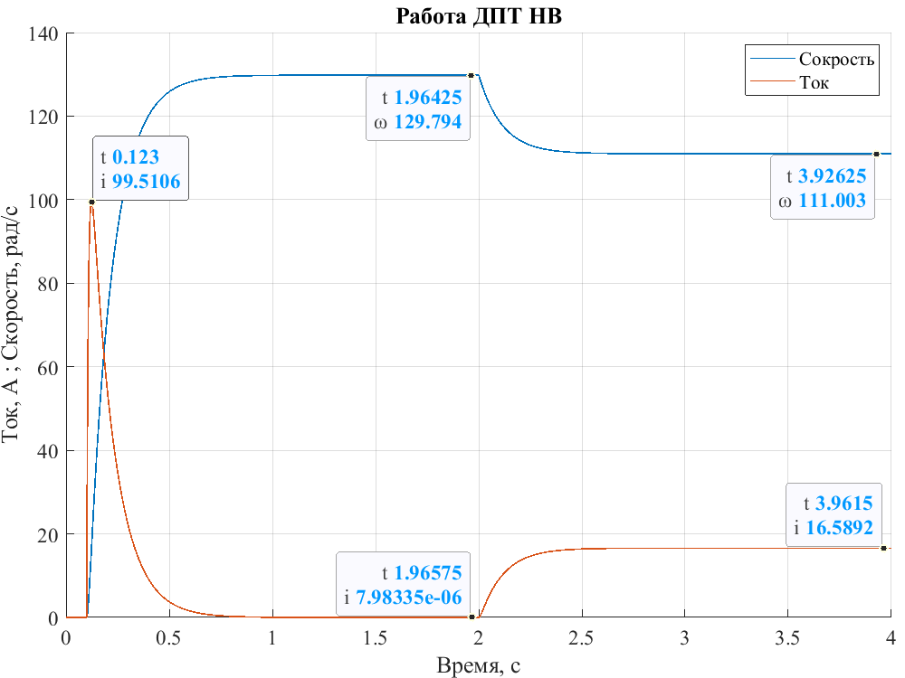
  <br><em>ЛБ1: модель ДПТ в Simulink и её проверка — прямой пуск и наброс номинальной нагрузки в момент 2 с</em>
</p>

## Зачем нужна двухконтурная САУ

При прямом пуске ток якоря в ЛБ1 доходил почти до 100 А при номинальном 16,6 А (график выше). Пока двигатель не разогнался, ЭДС почти нулевая, и ток ограничивает только маленькое сопротивление якоря. В ЛБ1 я решал это добавочными сопротивлениями: в начале пуска включены все, потом по времени или по скорости они по очереди закорачиваются.

<p align="center">
  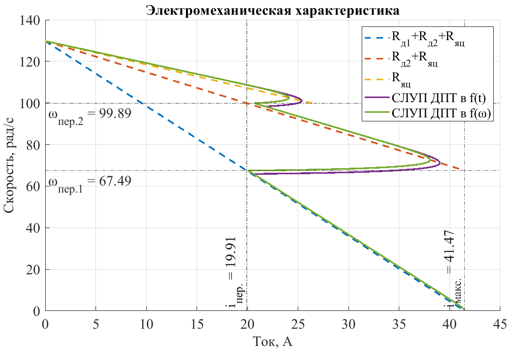
  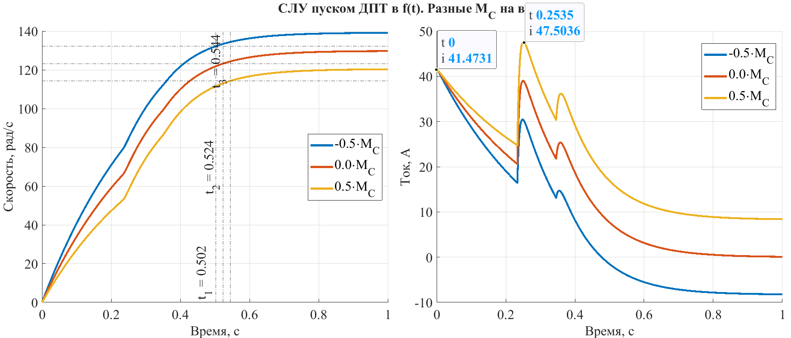
  <br><em>ЛБ1: пуск в две ступени. Ток скачет между 20 и 41 А, а при нагрузке +50 % превышает допустимые 41,5 А</em>
</p>

У такого пуска нашлись недостатки:

- **ток всё равно скачет** — на каждой ступени от тока переключения (≈ 20 А) до максимального (≈ 41,5 А), и момент скачет вместе с ним;
- **моменты переключения рассчитаны на одну нагрузку.** При нагрузке +50 % ток уже превышал допустимый (47,5 А), при моменте инерции +20 % — тоже (44,4 А);
- **скорость никто не держит** — она устанавливается там, где получится: от 120 до 139 рад/с в зависимости от нагрузки;
- в резисторах при каждом пуске теряется энергия.

Двухконтурная САУ решает ту же задачу по-другому. Регулятор скорости вычисляет, какой нужен ток, но не больше предела. Регулятор тока сам подбирает напряжение, чтобы ток был ровно таким. В итоге:

| | Пуск через сопротивления (ЛБ1) | Двухконтурная САУ (этот проект) |
|---|---|---|
| Ток при разгоне | скачет между ступенями | держится на пределе 20 А, разгон идёт по прямой |
| Нагрузка или инерция больше расчётной | ток превышает допустимый | ток всё равно не выше предела, просто разгон дольше |
| Скорость после разгона | зависит от нагрузки | держится на задании, после наброса нагрузки возвращается |
| Реверс и торможение | нужна отдельная схема | тот же регулятор, просто меняется знак задания |
| Потери | в добавочных резисторах | нет |

Разницу видно на GIF в начале README: оба режима записаны с одинаковыми моментами пуска, наброса нагрузки и реверса. Подробнее графики разобраны в разделе [Результаты](#результаты).

## Как это работает

### Структурная схема

<p align="center">
  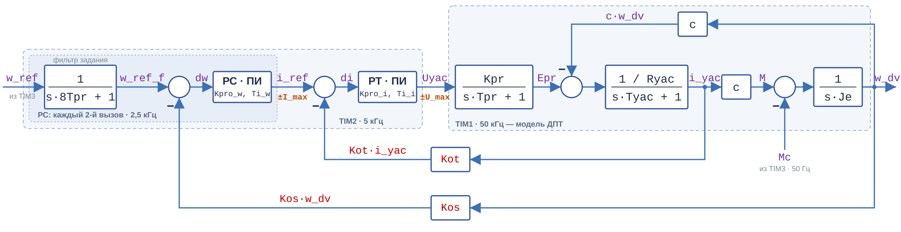
  <br><em>Структурная схема. Пунктиром показано, в прерывании какого таймера считается каждая часть</em>
</p>

Сигналы на схеме подписаны так же, как переменные в коде, их можно сразу искать в `model.h` и добавлять в MCUViewer. Соответствие обозначениям из лекций:

| В коде | В лекциях | Что это |
|---|---|---|
| `w_ref` | $U_{зс}$ | задание скорости |
| `w_ref_f` | — | задание скорости после фильтра |
| `dw` | $\Delta U_с$ | ошибка по скорости |
| `i_ref` (= `Out_w`) | $U_{рс} = U_{зт}$ | выход регулятора скорости = задание тока |
| `di` | $\Delta U_т$ | ошибка по току |
| `Uyac` (= `Out_i`) | $U_{рт} = U_{упр}$ | выход регулятора тока = напряжение управления |
| `Epr` | $E_{пр}$ | ЭДС преобразователя |
| `i_yac` | $i_{яц}$ | ток якоря |
| `M` = `c·i_yac` | $M_{дв}$ | момент двигателя |
| `Mc` | $M_с$ | момент нагрузки |
| `w_dv` | $\omega_{дв}$ | скорость двигателя |

### 1. Модель ДПТ

Модель состоит из трёх звеньев:

| Звено | Передаточная функция | Вход → выход |
|---|---|---|
| Преобразователь | $\dfrac{K_п}{T_п p + 1}$ | `Uyac` → `Epr` |
| Якорная цепь | $\dfrac{1/R_я}{T_я p + 1}$ | `Epr − c·w_dv` → `i_yac` |
| Механика | $\dfrac{1}{J p}$ | `c·i_yac − Mc` → `w_dv` |

Апериодическое звено $T\dot y + y = Kx$ методом Эйлера превращается в

$$
y_k = \frac{K\,dt}{T}\,x_k + \frac{T - dt}{T}\,y_{k-1}.
$$

Коэффициенты считаются один раз при старте, и в прерывании `TIM1` остаются три строчки (функция `Motor_Step()`):

```c
Epr = Uyac*K1pr + Epr*K2pr;                 // Преобразователь
i_yac = (Epr - c*w_dv)*K1yac + i_yac*K2yac; // Якорная цепь
w_dv = w_dv + (i_yac*c - Mc)*KJe;           // Механика
```

Шаг $dt$ = 20 мкс в 20 раз меньше самой маленькой постоянной времени ($T_п$ = 0,4 мс), так что метода Эйлера хватает.

### 2. Регулятор тока

Обычный ПИ-регулятор, настроенный на модульный оптимум, как в лекциях. Интегральная часть компенсирует постоянную времени якоря $T_я$, а коэффициент считается по постоянной преобразователя $T_\mu$:

$$
T_{рт} = T_я, \qquad K_{рт} = \frac{T_я\,R_я}{2\,T_\mu\,K_п\,K_{от}}.
$$

Для контура тока $T_\mu = T_п$ = 0,4 мс (`Tmu_i` в коде).

### 3. Регулятор скорости и фильтр задания

Тоже ПИ-регулятор, настроенный на симметричный оптимум:

$$
T_{рс} = 8\,T_\mu, \qquad K_{рс} = \frac{J\,K_{от}}{4\,T_\mu\,K_{ос}\,c}.
$$

На ступеньку задания такая настройка даёт большое перерегулирование (по теории около 43 %). Поэтому на вход контура стоит **фильтр задания**: он плавно подводит задание к новому значению, и перерегулирование почти пропадает. Подробнее — в [этапе 1](#этап-1-линейная-модель-как-в-лекциях).

$$
W_ф(p) = \frac{1}{8\,T_\mu\,p + 1}.
$$

Для контура скорости $T_\mu$ взята больше теоретической: `Tmu_w` = 5 мс. Почему — описано в [этапе 2](#этап-2-делаю-модель-физичной).

Регулятор скорости считается в том же прерывании, что и регулятор тока, **перед ним** и на каждом втором вызове. Так новое задание тока сразу попадает в регулятор тока.

### 4. Ограничения тока и напряжения

- **Ток** ограничен на выходе регулятора скорости: задание тока не больше ±`I_max` = 20 А.
- **Напряжение** ограничено на выходе регулятора тока: не больше ±`U_max` = 24 В, это напряжение питания.

Пока регулятор упирается в предел, его интегральная часть не должна копить ошибку. Иначе после выхода из ограничения она ещё долго держит выход на пределе, и скорость проскакивает задание. Поэтому в обоих регуляторах сделано **условное интегрирование**: интегратор обновляется, только если это не загоняет выход ещё дальше в предел.

```c
OutP_i = di * Kpro_i;
float temp_OutI_i = OutI_i + OutP_i * Kint_i;
float temp_Out_i = OutP_i + temp_OutI_i;

if (temp_Out_i > U_max)
{
    Out_i = U_max;
    if (di < 0) OutI_i = temp_OutI_i;  // интегрируем, только если это уводит от предела
}
else if (temp_Out_i < -U_max)
{
    Out_i = -U_max;
    if (di > 0) OutI_i = temp_OutI_i;
}
else
{
    Out_i = temp_Out_i;
    OutI_i = temp_OutI_i;
}
```

`I_max`, `U_max` и `Mload` объявлены `volatile`, их можно менять из MCUViewer во время работы.

### 5. Таймеры и прерывания

Все таймеры тактируются от 72 МГц. Частота прерывания $f = f_{TIM} / ((PSC + 1)(ARR + 1))$.

| Таймер | PSC | ARR | Частота | Функция | Что делает |
|---|---:|---:|---:|---|---|
| `TIM1` | 0 | 1440 − 1 | 50 кГц | `Motor_Step()` | модель ДПТ + запись для MCUViewer |
| `TIM2` | 0 | 14400 − 1 | 5 кГц | `Controllers_Step()` | регулятор скорости (каждый 2-й вызов) и регулятор тока |
| `TIM3` | 100 − 1 | 14400 − 1 | 50 Гц | `Reference_Step()` | смена режима, задание, момент нагрузки |

Обработчики прерываний в `stm32f1xx_it.c` только вызывают эти функции, сами функции лежат в `Project/Src/interrupt.c`. Приоритеты у всех прерываний одинаковые, порядок расчёта задан кодом.

Шаги дискретизации считаются из регистров таймеров функцией `Timer_Period()`. Если поменять частоту таймера в CubeMX, коэффициенты пересчитаются сами. Сколько вызовов регулятора тока приходится на один вызов регулятора скорости, задаёт макрос `REG_W_DIV`.

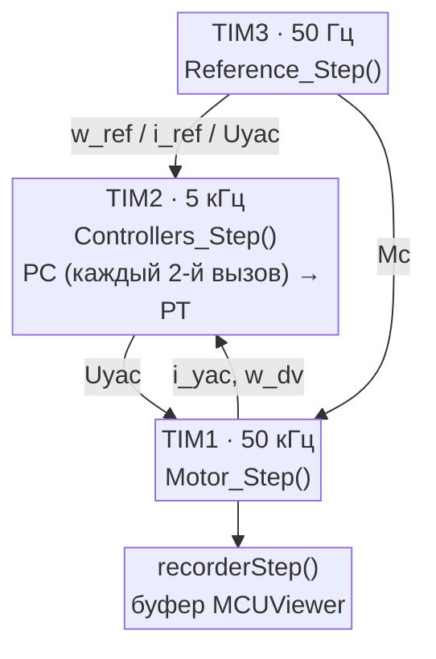

### 6. Режимы работы

Режимы описаны таблицей в `model.c`:

```c
const Mode_Config Modes[MODE_COUNT] =
{
    [MODE_OPEN_LOOP] = { .half_period = 3.0f, .amplitude = 24.0f  },
    [MODE_CURRENT]   = { .half_period = 0.2f, .amplitude = 10.0f  },
    [MODE_SPEED]     = { .half_period = 3.0f, .amplitude = 20.0f  },
};
```

| `Mode` | Что работает | Задание | Знак задания меняется |
|:---:|---|---|---|
| 0 `MODE_OPEN_LOOP` | только двигатель с преобразователем, без регуляторов | `Uyac` = ±24 В | каждые 3 с |
| 1 `MODE_CURRENT` | контур тока | `i_ref` = ±10 А | каждые 0,2 с |
| 2 `MODE_SPEED` | оба контура | `w_ref` = ±20 рад/с | каждые 3 с |

Задания подобраны так, чтобы их можно было достичь при 24 В. Во второй половине каждого полупериода включается нагрузка `Mc = ±Mload` (5 Н·м) того же знака, что и задание.

**Переключение из MCUViewer.** Нужно записать номер режима в `Mode_Request`. В ближайшем прерывании `TIM3` прошивка вызовет `Set_Mode()`: пересчитает период задания, обнулит интеграторы регуляторов и фильтр. Состояние двигателя при этом сохраняется.

**Режим после reset.** `Set_Mode()` записывает номер режима в backup-регистр `BKP->DR1`, а при старте `Init_Variables()` его читает. Этот регистр не очищается кнопкой reset и перепрошивкой, только при полном отключении питания. Тогда плата стартует в разомкнутом режиме.

### 7. MCUViewer

Проект MCUViewer — `engine_model.mcuv` в корне. В нём три вида групп:

- **обычные** (`current`, `speed`, `simulation`): MCUViewer опрашивает переменные по SWD примерно 2000 раз в секунду. Подходит для процессов длиной в секунды;
- **с Recorder** (`current_highres`, `speed_highres`): `recorderStep()` вызывается в прерывании `TIM1` и записывает переменные в буфер на каждом шаге модели. Так видны процессы длиной в миллисекунды с частотой 50 кГц;
- **таблица** `variables`: через неё удобно менять `Mode_Request`, `Mload`, `I_max`, `U_max`.

## Как я доводил систему

### Этап 1. Линейная модель, как в лекциях

Сначала прошивка повторяла пример из лекций: ограничений тока и напряжения нет, у каждого регулятора свой таймер. Контур тока работал как надо, а у контура скорости на реверсе с −100 до +100 рад/с перерегулирование было **85 %** — вдвое больше теоретического.

<p align="center">
  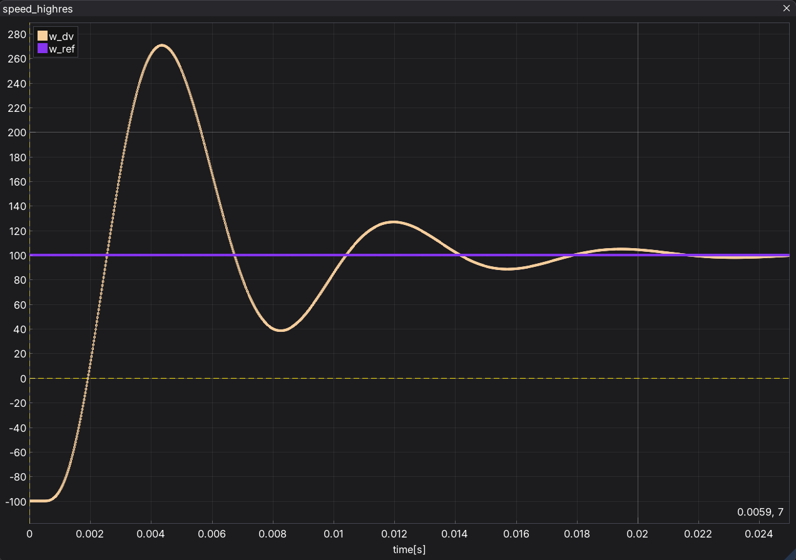
  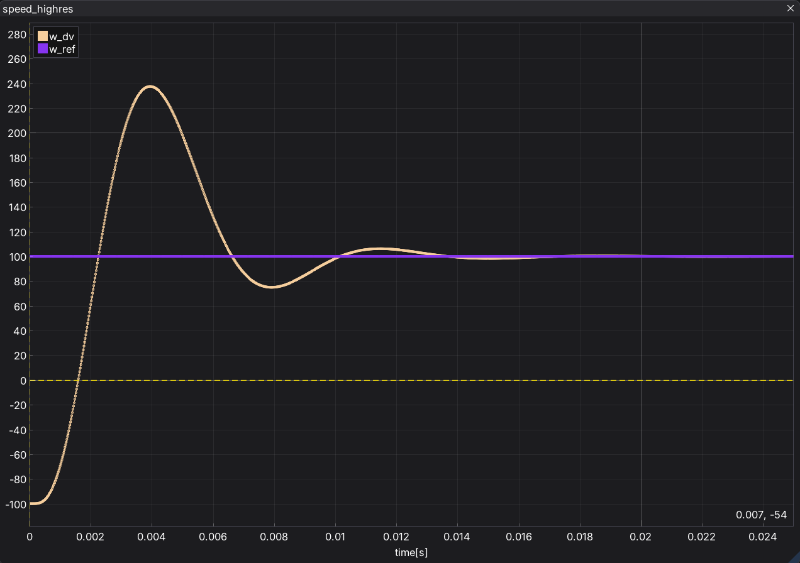
  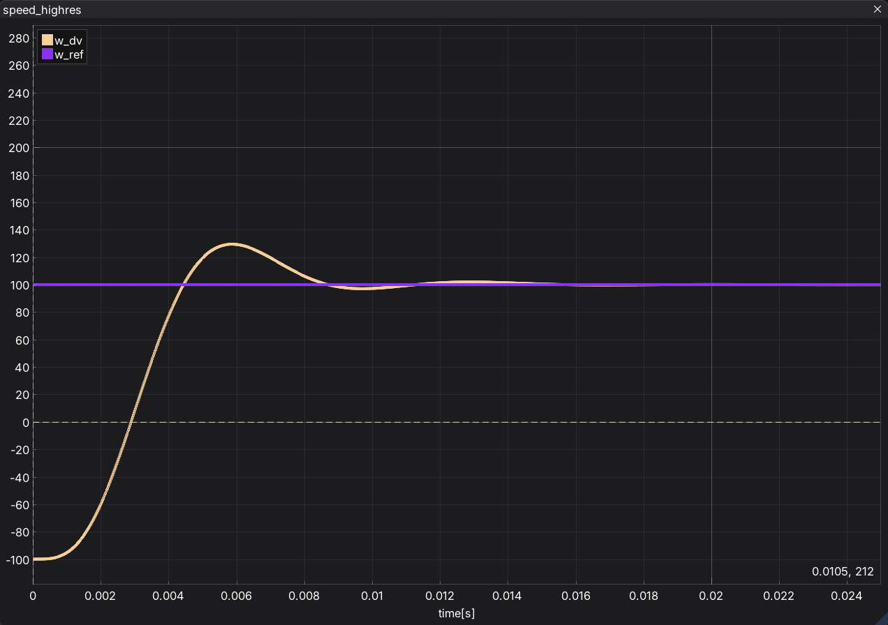
  <br><em>Реверс скорости в линейной модели: исходная версия (85 %) → поменял порядок регуляторов (69 %) → добавил фильтр задания (15 %)</em>
</p>

Причин оказалось две.

**Порядок прерываний.** Регулятор тока (`TIM2`) и регулятор скорости (`TIM3`) срабатывали одновременно. Приоритеты одинаковые, поэтому первым выполнялся тот, у кого меньше номер прерывания, — регулятор тока. Он считал со старым заданием тока, а новое попадало в него только через 0,2 мс. Эта лишняя задержка раскачивала контур скорости. Я перенёс регулятор скорости в прерывание `TIM2` и поставил его перед регулятором тока: **69 %**.

**Нет фильтра задания.** Симметричный оптимум на ступеньку задания сам по себе даёт большое перерегулирование. В числителе передаточной функции замкнутого контура скорости остаётся форсирующее звено $8T_\mu p + 1$ от ПИ-регулятора. В момент ступеньки ошибка скачет сразу на 200 рад/с, и регулятор выдаёт огромное задание тока. Фильтр $\frac{1}{8T_\mu p + 1}$ на входе сокращает это звено, и ступенька превращается в плавную экспоненту. С ним стало **15 %**.

Контур тока в линейной модели отрабатывает ступеньку ±10 А с перерегулированием около 7 %:

<p align="center">
  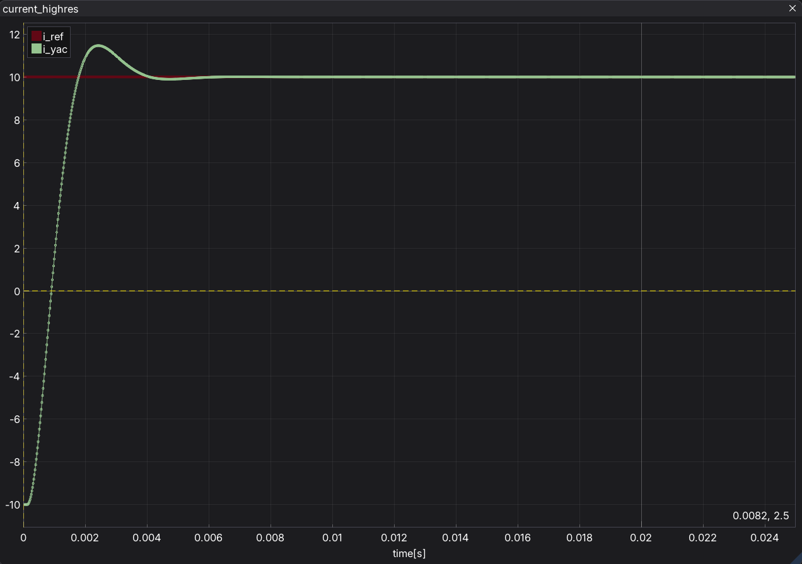
  <br><em>Контур тока в линейной модели: реверс задания ±10 А (Recorder, 50 кГц)</em>
</p>

### Этап 2. Делаю модель физичной

У линейной модели была проблема: при реверсе скорости ток якоря уходил в тысячи ампер. Настоящий двигатель так не может, поэтому я начал добавлять ограничения.

**1. Ограничение тока 20 А.** Задание тока на выходе регулятора скорости ограничено ±20 А, а интегратор защищён условным интегрированием. Ток перестал уходить в тысячи, но я заметил, что теперь **регулятор тока выдаёт около 1500 В**. Это логично: настройка на модульный оптимум рассчитана на то, что ток изменится за пару миллисекунд, а при индуктивности якоря $L_я = T_я R_я$ = 0,075 Гн для этого нужно

$$
U = L_я\frac{di}{dt} \approx 0{,}075 \cdot \frac{20 \text{ А}}{0{,}001 \text{ с}} = 1500 \text{ В}.
$$

В модели преобразователь — линейное звено, поэтому он «выдавал» любое напряжение.

**2. Ограничение напряжения 24 В.** Выход регулятора тока ограничил ±24 В, тоже с условным интегрированием. Сразу выяснилось, что старое задание ±100 рад/с теперь недостижимо: в установившемся режиме $U = R_я i + c\,\omega$, и под нагрузкой 5 Н·м (ток 7,1 А) максимальная скорость

$$
\omega_{max} = \frac{24 - 0{,}75 \cdot 7{,}1}{0{,}7} \approx 26{,}6 \text{ рад/с}.
$$

Задание поменял на ±20 рад/с, а полупериод увеличил до 3 с: разгон теперь ограничен током и занимает больше полсекунды. Такой же полупериод у разомкнутого режима, поэтому их удобно сравнивать.

**3. Автоколебания.** После этого скорость перестала успокаиваться и всё время качалась около задания примерно на ±1 рад/с:

<p align="center">
  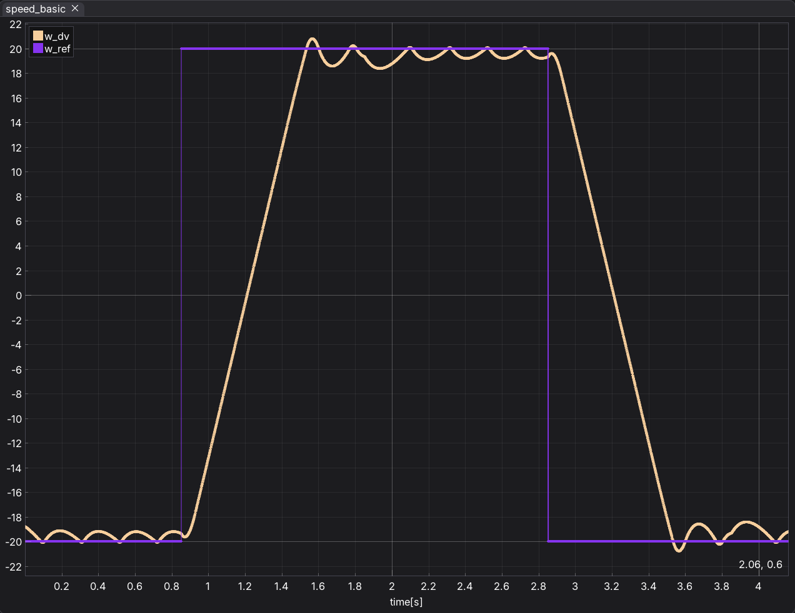
  <br><em>Автоколебания скорости: регуляторы ещё настроены как для линейной модели</em>
</p>

Причина в том, что регуляторы были настроены под «бесконечное» напряжение. Коэффициенты огромные: регулятор скорости упирается в предел 20 А уже при ошибке 0,11 рад/с, а регулятор тока упирается в 24 В при ошибке 0,26 А. При этом ток физически не может меняться быстро. Под нагрузкой на 20 рад/с преобразователь уже выдаёт 19,4 В, и на увеличение тока остаётся всего 4,6 В, то есть ток растёт не быстрее $4{,}6 / 0{,}075 \approx 61$ А/с. Регуляторы работают как реле «полный ток туда — полный ток обратно», а ток за ними не успевает. Отсюда и колебания.

**4. Перенастройка контура скорости.** Контур скорости должен ждать от контура тока той скорости, которую тот реально может дать при 24 В. Для этого я ввёл отдельную постоянную `Tmu_w`, по которой настраивается только регулятор скорости и фильтр задания. Контур тока остался на `Tmu_i` = $T_п$ = 0,4 мс: если замедлить и его, в режиме тока ток не успевает дойти до задания за полупериод.

Точно посчитать `Tmu_w` формулой сложно: граница зависит от ограничений и от рабочей точки. Можно только оценить диапазон. Снизу это $T_п$ = 0,4 мс: при ней есть колебания. Сверху — постоянная, при которой регулятор вообще никогда не упирается в напряжение, порядка 0,1 с, но это слишком медленно. Внутри этого диапазона значение подбирается экспериментом: колебания пропадают примерно с 3 мс, я взял **5 мс** с запасом.

### Грабли

- **Фильтр, который ни на что не влиял.** Я добавил расчёт `w_ref_f`, но ошибку по скорости продолжал считать от нефильтрованного `w_ref`.
- **Порядок регуляторов через приоритеты.** Сначала я пробовал задать порядок приоритетами NVIC: `TIM3` выше `TIM2`. Процесс стал расходящимся. Приоритет вытеснения меняет не только порядок: модель в `TIM1` с приоритетом 0 начала прерывать регуляторы посреди расчёта. В Cortex-M3 нет FPU, вся арифметика с `float` программная, и регуляторы, видимо, стали считаться урывками, с большой задержкой. Порядок, записанный кодом в одном прерывании, оказался проще и надёжнее.
- **Шаг регулятора скорости.** Перейдя на `REG_W_DIV`, я сначала написал `dt_w = dt_i / REG_W_DIV`. Регулятор скорости вызывается реже регулятора тока, значит, шаг у него больше: правильно `dt_i * REG_W_DIV`.
- **Регулятор, который не обновлял выход.** Переписав ограничение через временные переменные, я в ветке `else` обновлял только интегратор, а выход забыл. В линейной зоне выход оставался равным ±24 В, и регулятор тока работал как реле: напряжение прыгало между +24 и −24 В.
- **Выбросы на графике.** До этого выход сначала записывался в глобальную переменную без ограничения и только потом обрезался. MCUViewer иногда читал память ровно между этими строками и показывал выбросы до сотен вольт, хотя в модель они не попадали. Теперь выход записывается один раз, уже после ограничения.
- **Режим после reset.** Плата стартовала не в выбранном режиме, а в зашитом в коде. Отсюда сохранение режима в backup-регистре.

## Результаты

**Режим скорости** (±20 рад/с, нагрузка 5 Н·м):

<p align="center">
  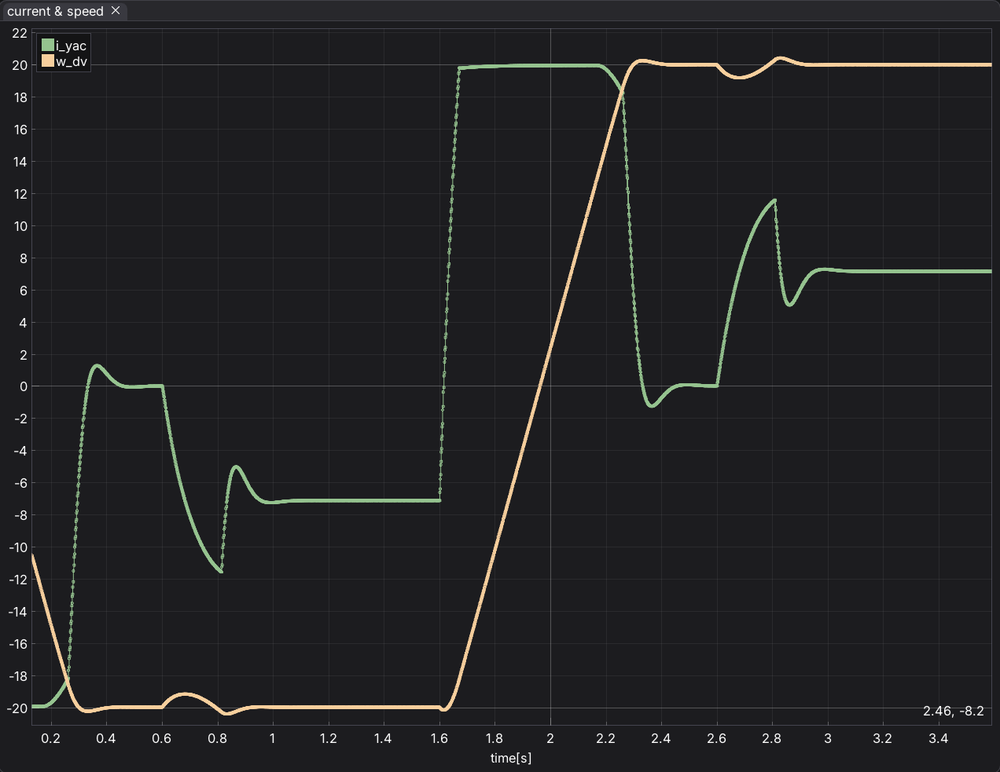
  <br><em>Скорость и ток якоря: разгон на пределе тока 20 А, выход на задание и наброс нагрузки</em>
</p>

- При реверсе ток сразу выходит на предел 20 А и держится на нём, поэтому скорость меняется по прямой. Реверс с −20 до +20 рад/с занимает около 0,65 с.
- В конце разгона ток немного проседает ниже 20 А: на этой скорости уже не хватает 24 В (см. следующий график).
- Скорость выходит на задание почти без перерегулирования (около 20,3 рад/с).
- При набросе 5 Н·м скорость проседает примерно до 19,3 рад/с и возвращается к 20. Ток устанавливается на $5 / 0{,}7 \approx 7{,}1$ А — ровно столько, сколько нужно для момента нагрузки.

<p align="center">
  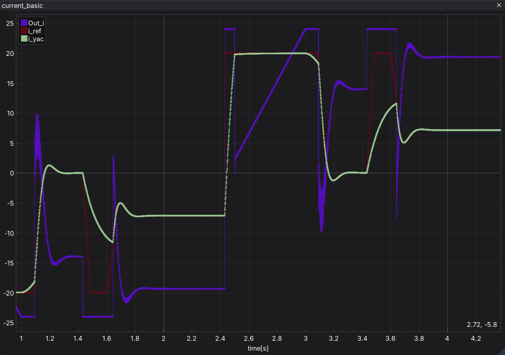
  <br><em>Задание тока, ток якоря и напряжение на выходе регулятора тока</em>
</p>

Напряжение `Out_i` хорошо объясняется формулой $U = R_я i + c\,\omega + L_я\,di/dt$:

- в начале разгона ток надо быстро поднять, и напряжение упирается в 24 В;
- потом ток постоянный (20 А), а напряжение растёт по прямой вместе со скоростью: $0{,}75 \cdot 20 + 0{,}7\,\omega$;
- примерно на 13 рад/с оно снова упирается в 24 В, и ток начинает проседать;
- без нагрузки на 20 рад/с остаётся $c\,\omega$ = 14 В, с нагрузкой — $0{,}75 \cdot 7{,}1 + 14 \approx 19{,}4$ В.

**Сравнение с разомкнутым режимом.** На [GIF в начале](#имитационная-модель-дпт-и-двухконтурной-сау-на-stm32) оба режима записаны синхронно: пуск, наброс нагрузки и реверс происходят в одни и те же моменты.

- **Без регуляторов** скорость выходит на $24 / 0{,}7 \approx 34$ рад/с, а при набросе нагрузки проседает до 26,7 рад/с и там остаётся. При реверсе ток ничем не ограничен и доходит почти до 40 А.
- **С регуляторами** при набросе нагрузки скорость проседает меньше чем на 1 рад/с и возвращается к 20. При реверсе ток держится на пределе 20 А.
- **Время выхода на уставку.** Без регуляторов после реверса скорость подходит к установившемуся значению по экспоненте и почти устанавливается только примерно через 1,1 с, хотя ток в начале доходит до 40 А. С регуляторами скорость меняется по прямой и выходит на задание примерно за 0,65 с при токе вдвое меньше.

## Параметры модели

Все параметры задаются в `Init_Variables()` ([`Project/Src/model.c`](Project/Src/model.c)).

| Переменная | Значение | Описание |
|---|---|---|
| `dt`, `dt_i`, `dt_w`, `dt_ref` | 20 мкс, 200 мкс, 400 мкс, 20 мс | шаги модели, регулятора тока, регулятора скорости и задатчика (из настроек таймеров) |
| `Kpr`, `Tpr` | 1; 0,4 мс | коэффициент и постоянная времени преобразователя |
| `Ryac`, `Tyac` | 0,75 Ом; 0,1 с | сопротивление и постоянная времени якоря ($L_я$ = 0,075 Гн) |
| `c` | 0,7 В·с/рад | конструктивная постоянная |
| `Je` | 0,2 кг·м² | момент инерции |
| `U_max` | 24 В | напряжение питания преобразователя |
| `I_max` | 20 А | ограничение тока |
| `Mload` | 5 Н·м | наброс нагрузки |
| `Kot`, `Kos` | 1; 1 | коэффициенты обратных связей по току и скорости |
| `Tmu_i` | 0,4 мс | малая постоянная для настройки контура тока (= `Tpr`) |
| `Tmu_w` | 5 мс | малая постоянная для настройки контура скорости |

Коэффициенты регуляторов, которые из них получаются:

| Звено | Коэффициент | Постоянная времени |
|---|---|---|
| регулятор тока | `Kpro_i` = 93,75 | `Ti_i` = $T_я$ = 0,1 с |
| регулятор скорости | `Kpro_w` ≈ 14,3 | `Ti_w` = $8\,T_{\mu w}$ = 40 мс |
| фильтр задания | `Kf_w` = 0,01 | $8\,T_{\mu w}$ = 40 мс |

## Структура проекта

```
engine_model/
├── Core/                         # код, сгенерированный STM32CubeMX
│   └── Src/
│       ├── main.c                # Init_Variables() и запуск таймеров
│       ├── tim.c                 # настройка TIM1–TIM3
│       └── stm32f1xx_it.c        # обработчики прерываний: только вызовы функций из interrupt.c
├── Project/
│   ├── Inc/
│   │   ├── model.h               # переменные модели, режимы, REG_W_DIV
│   │   └── interrupt.h           # функции, которые вызываются из прерываний
│   └── Src/
│       ├── model.c               # параметры, таблица режимов, Timer_Period(), Set_Mode()
│       └── interrupt.c           # модель ДПТ, регуляторы, задатчик
├── Recorder/                     # recorder MCUViewer
├── docs/images/                  # схема, скриншоты и GIF для README
├── engine_model.mcuv             # проект MCUViewer
├── engine_model.ioc              # проект STM32CubeMX
├── Makefile, STM32Make.make      # сборка
└── openocd.cfg                   # ST-Link + stm32f1x
```

## Сборка и прошивка

Что нужно: плата с STM32F103C8T6 (например, Blue Pill), ST-Link V2, VS Code с расширениями STM32 for VSCode и Cortex-Debug, `arm-none-eabi-gcc` 13.2.1, OpenOCD, пакет STM32CubeF1 1.8.6 (драйверы HAL берутся из репозитория STM32Cube) и MCUViewer 1.2.1.

```powershell
git clone https://github.com/Izolentiy/engine-simulator-stm32.git
cd engine-simulator-stm32
make -f STM32Make.make
```

В VS Code то же самое делают задачи **Build STM** и **Flash STM**, а отладку запускает конфигурация **Debug STM32**. Для графиков закройте отладку (ST-Link может держать только одна программа), откройте `engine_model.mcuv` в MCUViewer и запустите захват.

## Что можно улучшить

- **Параметры реального двигателя.** Параметры взяты из лекций, и для 24 В они не очень реалистичны: индуктивность якоря 75 мГн большая, из-за неё ток меняется медленно, и контур скорости пришлось замедлить. Можно взять паспортные данные реального низковольтного двигателя, например maxon RE 50 (24 В, номинальный ток 10,8 А, индуктивность 0,07 мГн).
- **`Tmu_w` подобрана под одну рабочую точку** (±20 рад/с, нагрузка 5 Н·м). При других заданиях и нагрузках границу устойчивости стоит проверить заново.

## Источники

1. Ланграф С. В. Лекции по дисциплине «Встраиваемые вычислительные системы»
2. [MCUViewer](https://mcuviewer.com) — документация и Recorder.
3. [RM0008: Reference manual STM32F101xx/102xx/103xx/105xx/107xx](https://www.st.com/resource/en/reference_manual/rm0008-stm32f101xx-stm32f102xx-stm32f103xx-stm32f105xx-and-stm32f107xx-advanced-armbased-32bit-mcus-stmicroelectronics.pdf) — STMicroelectronics.

---

**Автор:** Мунконов Н. Е., ТПУ, группа 8Е22
**Преподаватель:** Ланграф С. В. к.т.н., доцент, ОАР ИШИТР ТПУ
